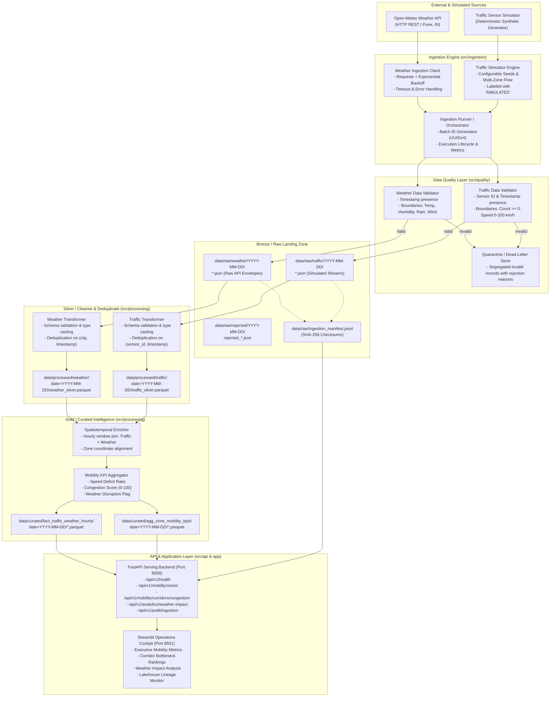

# CITYSENSE: Smart City Mobility & Infrastructure Intelligence Platform

[](https://www.python.org/)
[](LICENSE)
[](tests/)
[](https://fastapi.tiangolo.com/)
[](https://streamlit.io/)
[](https://parquet.apache.org/)
[](https://open-meteo.com/)

> **Milestones 1, 2 & 3 Complete**: Multi-Source Ingestion Engine, Data Quality Quarantine, Medallion Bronze-to-Silver Cleansing, Silver-to-Gold Spatiotemporal Enrichment & KPI Modeling, FastAPI High-Performance Serving Layer, Streamlit Operations Dashboard, Containerization, and Automated Pytest Verification Suite.

---

## 1. Project Purpose & Highlights

**CITYSENSE** is an enterprise-grade smart city mobility and urban infrastructure intelligence platform. Designed for production data engineering and analytical intelligence, the platform ingests, validates, cleanses, enriches, and serves heterogeneous high-velocity urban data streams—including vehicular traffic flows, meteorological dynamics, and corridor congestion indexes across Pune, India (`18.5204° N, 73.8567° E`).

### Complete Platform Capabilities Across All Milestones

1. **Multi-Source Ingestion Engine (Bronze Layer)**:
   - Resilient HTTP client for Open-Meteo REST API with connection/read timeouts (`5s / 15s`), urllib3 exponential backoff retries (`429, 500, 502, 503, 504`), and embedded CC BY 4.0 license attribution.
   - High-fidelity synthetic traffic sensor simulator modeling rush-hour congestion across 5 Pune corridors (`Shivaji Nagar CBD`, `Hinjewadi Tech Corridor`, `Pune Station Transit Hub`, `Kothrud West`, `Viman Nagar East`) with deterministic reproducibility seeds and explicit `SIMULATED` flags.
2. **Data Quality & Quarantine Layer**:
   - Pre-storage schema and physical boundary enforcement: missing sensor IDs, unparseable timestamps, negative vehicle counts, out-of-range speeds, and extreme weather values.
   - Segregates valid batches from rejected records, isolating invalid rows with diagnostic `rejection_reasons` to a dead-letter quarantine directory (`data/raw/rejected/`).
3. **Medallion Data Lakehouse Architecture**:
   - **Bronze (Landing)**: Immutable date-partitioned raw JSON files with UUIDv4 batch IDs and append-only SHA-256 manifest tracking.
   - **Silver (Cleansed)**: Deduplicated on natural keys (`(sensor_id, timestamp)` for traffic, `(city, timestamp)` for weather), strongly typed Apache Parquet columnar storage (`data/processed/`).
   - **Gold (Curated)**: Spatiotemporally joined and KPI-enriched analytical Parquet tables (`data/curated/`): `fact_traffic_weather_hourly` and `agg_zone_mobility_kpis`.
4. **Smart City Mobility KPIs**:
   - *Speed Deficit Ratio*: $\max\left(0, \frac{v_{\text{limit}} - v_{\text{avg}}}{v_{\text{limit}}}\right)$
   - *Mobility Congestion Score (0–100)*: Composite weighted index coupling physical occupancy with velocity drop.
   - *Weather Disruption Indicator*: Flags observations where precipitation ($> 1.0\text{ mm}$) or high winds ($> 30\text{ km/h}$) degrade urban mobility.
   - *Corridor Throughput*: Projected hourly vehicular capacity under prevailing speeds.
5. **High-Performance FastAPI Serving Layer**:
   - Asynchronous REST API serving curated Gold and Silver data with sub-millisecond columnar Parquet queries.
   - Interactive OpenAPI documentation at `/docs` (Swagger UI) and `/redoc`.
6. **Interactive Streamlit Operations Dashboard**:
   - Real-time city cockpit with executive KPI cards, corridor bottleneck rankings, weather-mobility impact analysis, and data engineering pipeline observability.
7. **Containerization & Deployment Ready**:
   - Production multi-stage `Dockerfile` and `docker-compose.yml` linking the API service and Streamlit dashboard.
8. **Automated Pytest Suite (43 Tests Passed)**:
   - 100% network-isolated automated unit and integration tests across ingestion, quality, storage, transformations, and REST API endpoints.

---

## 2. End-to-End System Architecture



---

## 3. Technology Stack

- **Backend & Serving**: `fastapi>=0.110.0`, `uvicorn>=0.24.0`, `pydantic>=2.9.0`, `pydantic-settings>=2.1.0`
- **Analytics & Storage**: `pandas>=2.1.0`, `pyarrow>=21.0.0`, `numpy>=1.26.0`, Apache Parquet (Snappy)
- **Visualization**: `streamlit>=1.50.0`
- **HTTP & Resilience**: `requests`, `urllib3.util.retry.Retry`, `requests.adapters.HTTPAdapter`
- **Testing & Verification**: `pytest>=8.0.0`, `unittest.mock`
- **Deployment**: Docker, Docker Compose

---

## 4. Directory & Folder Structure

```text
CITYSENSE/
├── .env.example                     # Environment template (API URLs, timeouts, retry counts)
├── .gitignore                       # Git ignore for venvs, caches, raw data, logs
├── README.md                        # Production documentation & Open-Meteo attribution
├── requirements.txt                 # Production and testing dependencies
├── Dockerfile                       # Production multi-stage Docker build
├── docker-compose.yml               # Service orchestration (FastAPI + Streamlit)
├── app/
│   └── streamlit_app.py             # Streamlit visual mobility operations dashboard
├── config/
│   ├── __init__.py
│   ├── settings.py                  # Pydantic-based centralized configuration
│   └── zones.json                   # Fictional Pune city mobility zones definition
├── data/
│   ├── raw/
│   │   ├── traffic/                 # Bronze: Date-partitioned raw traffic sensor batches
│   │   ├── weather/                 # Bronze: Date-partitioned raw Open-Meteo weather batches
│   │   ├── air_quality/             # Reserved for future expansion
│   │   ├── incidents/               # Reserved for future expansion
│   │   ├── rejected/                # Bronze: Quarantined invalid records with failure reasons
│   │   └── ingestion_manifest.jsonl # Bronze: Append-only audit manifest with SHA256 checksums
│   ├── processed/
│   │   ├── _processing_manifest.jsonl       # Silver: Transformation audit trail
│   │   ├── traffic/date=YYYY-MM-DD/         # Silver: Cleaned, deduplicated traffic Parquet
│   │   └── weather/date=YYYY-MM-DD/         # Silver: Cleaned, deduplicated weather Parquet
│   └── curated/
│       ├── fact_traffic_weather_hourly/     # Gold: Enriched fact table Parquet
│       └── agg_zone_mobility_kpis/          # Gold: Zone-level hourly KPI aggregates Parquet
├── docs/
│   ├── api_reference.md             # REST API endpoint reference and curl examples
│   ├── architecture.md              # Technical architecture & design rationale
│   ├── data_dictionary.md           # Field dictionary for Bronze, Silver & Gold schemas
│   ├── sample_payloads.md           # Sample JSON and Parquet schemas
│   └── transformation_spec.md       # Medallion transformations and KPI formulas
├── logs/
│   └── citysense.log                # Rotating structured JSON log file
├── src/
│   ├── __init__.py
│   ├── api/
│   │   ├── __init__.py
│   │   ├── main.py                  # FastAPI application entrypoint
│   │   ├── schemas.py               # Pydantic v2 API response models
│   │   ├── services.py              # Columnar Parquet query and aggregation service
│   │   └── routes/
│   │       ├── __init__.py
│   │       ├── health.py            # Health & partition discovery router
│   │       ├── mobility.py          # Zone and corridor mobility router
│   │       ├── analytics.py         # Weather-mobility correlation router
│   │       └── audit.py             # Lakehouse audit manifest router
│   ├── ingestion/
│   │   ├── __init__.py
│   │   ├── weather_client.py        # Open-Meteo client with retries and backoff
│   │   ├── traffic_simulator.py     # Deterministic multi-zone traffic generator
│   │   └── runner.py                # Batch ingestion runner & CLI orchestrator
│   ├── quality/
│   │   ├── __init__.py
│   │   ├── base.py                  # Abstract validator interface & ValidationResult
│   │   ├── weather_validator.py     # Atmospheric boundary & structural validation
│   │   └── traffic_validator.py     # Traffic sensor boundary & anomaly validation
│   ├── processing/
│   │   ├── __init__.py
│   │   ├── weather_transformer.py   # Bronze-to-Silver weather cleansing & deduplication
│   │   ├── traffic_transformer.py   # Bronze-to-Silver traffic cleansing & deduplication
│   │   ├── enricher.py              # Silver-to-Gold spatiotemporal join & KPI calculation
│   │   └── runner.py                # Medallion transformation pipeline CLI
│   ├── storage/
│   │   ├── __init__.py
│   │   └── raw_storage.py           # Immutable date-partitioned storage manager
│   └── utils/
│       ├── __init__.py
│       ├── exceptions.py            # Domain-specific exception hierarchy
│       ├── logger.py                # Structured JSON logging formatter & handler
│       └── time_utils.py            # Standardized UTC / ISO-8601 formatting helpers
└── tests/
    ├── __init__.py
    ├── conftest.py                  # Shared fixtures and mock responses
    ├── test_api.py                  # FastAPI serving layer integration tests
    ├── test_enricher.py             # Spatiotemporal join and KPI calculation tests
    ├── test_processing_runner.py    # Medallion transformation pipeline tests
    ├── test_quality.py              # Positive & negative record quality checks
    ├── test_runner.py               # Ingestion runner integration tests
    ├── test_storage.py              # File writing, partition structure & immutability tests
    ├── test_traffic_simulator.py    # Simulator seed reproducibility & schema validation
    ├── test_traffic_transformer.py  # Traffic Silver cleansing & schema validation tests
    ├── test_weather_client.py       # Weather API tests (mocked HTTP, retries, errors)
    └── test_weather_transformer.py  # Weather Silver cleansing & deduplication tests
```

---

## 5. Quickstart & Execution Guide

### 1. Ingest Raw Streams (Bronze Layer)
```bash
# Ingest both traffic and weather streams
python -m src.ingestion.runner --source both --records 25 --seed 42 --city Pune

# Ingest traffic with anomaly injection to verify quality quarantine
python -m src.ingestion.runner --source traffic --records 20 --seed 123 --simulate-anomalies
```

### 2. Run Medallion Transformations (Silver & Gold Layers)
```bash
# Process all discovered dates across Silver and Gold layers
python -m src.processing.runner --all-dates
```

### 3. Start the FastAPI Serving Layer
```bash
# Start backend server on port 8000
python -m uvicorn src.api.main:app --host 0.0.0.0 --port 8000 --reload

# Open Swagger UI documentation:
# http://localhost:8000/docs
```

### 4. Launch the Streamlit Operations Dashboard
```bash
# Launch interactive dashboard on port 8501
streamlit run app/streamlit_app.py

# Open in browser:
# http://localhost:8501
```

### 5. Run via Docker Compose
```bash
# Build and run both FastAPI and Streamlit services
docker compose up --build
```

---

## 6. Automated Testing Suite

All 43 automated unit and integration tests run in **complete network isolation** with zero external network dependencies:

```bash
python -m pytest tests/ -v
```

### Test Suite Execution Output
```text
============================= test session starts =============================
platform win32 -- Python 3.12.4, pytest-9.2.0, pluggy-1.7.0
rootdir: C:\Users\utkar\.gemini\antigravity\scratch\CITYSENSE
collected 43 items

tests/test_api.py::TestCitySenseAPI::test_root_endpoint PASSED           [  2%]
tests/test_api.py::TestCitySenseAPI::test_health_endpoint PASSED         [  4%]
tests/test_api.py::TestCitySenseAPI::test_get_zones_summary PASSED       [  6%]
tests/test_api.py::TestCitySenseAPI::test_get_zone_kpis_valid_zone PASSED [  9%]
tests/test_api.py::TestCitySenseAPI::test_get_zone_kpis_invalid_zone_raises_404 PASSED [ 11%]
tests/test_api.py::TestCitySenseAPI::test_get_corridors_congestion_ranking PASSED [ 13%]
tests/test_api.py::TestCitySenseAPI::test_weather_impact_analytics PASSED [ 16%]
tests/test_api.py::TestCitySenseAPI::test_audit_ingestion_manifest PASSED [ 18%]
tests/test_api.py::TestCitySenseAPI::test_audit_processing_manifest PASSED [ 20%]
tests/test_enricher.py::TestSpatioTemporalEnricher::test_enrichment_and_kpi_calculations PASSED [ 23%]
tests/test_processing_runner.py::TestProcessingPipelineOrchestrator::test_run_pipeline_end_to_end PASSED [ 25%]
tests/test_quality.py::TestTrafficDataValidator::test_valid_record_passes PASSED [ 27%]
tests/test_quality.py::TestTrafficDataValidator::test_missing_sensor_id_rejected PASSED [ 30%]
tests/test_quality.py::TestTrafficDataValidator::test_missing_timestamp_rejected PASSED [ 32%]
tests/test_quality.py::TestTrafficDataValidator::test_negative_vehicle_count_rejected PASSED [ 34%]
tests/test_quality.py::TestTrafficDataValidator::test_invalid_speed_values_rejected PASSED [ 37%]
tests/test_quality.py::TestTrafficDataValidator::test_invalid_occupancy_rejected PASSED [ 39%]
tests/test_quality.py::TestWeatherDataValidator::test_valid_weather_record_passes PASSED [ 41%]
tests/test_quality.py::TestWeatherDataValidator::test_missing_weather_timestamp_rejected PASSED [ 44%]
tests/test_quality.py::TestWeatherDataValidator::test_extreme_temperature_rejected PASSED [ 46%]
tests/test_quality.py::TestWeatherDataValidator::test_invalid_humidity_rejected PASSED [ 48%]
tests/test_quality.py::TestWeatherDataValidator::test_negative_rain_rejected PASSED [ 51%]
tests/test_runner.py::TestIngestionRunnerIntegration::test_run_weather_ingestion_end_to_end PASSED [ 53%]
tests/test_runner.py::TestIngestionRunnerIntegration::test_run_traffic_ingestion_with_anomalies_quarantine PASSED [ 55%]
tests/test_storage.py::TestRawStorageManager::test_save_batch_creates_partitioned_file PASSED [ 58%]
tests/test_storage.py::TestRawStorageManager::test_save_batch_immutability_prevents_overwrite PASSED [ 60%]
tests/test_storage.py::TestRawStorageManager::test_manifest_file_appends_records PASSED [ 62%]
tests/test_storage.py::TestRawStorageManager::test_save_rejected_records_quarantine PASSED [ 65%]
tests/test_traffic_simulator.py::TestTrafficSensorSimulator::test_record_generation_count PASSED [ 67%]
tests/test_traffic_simulator.py::TestTrafficSensorSimulator::test_seed_reproducibility PASSED [ 69%]
tests/test_traffic_simulator.py::TestTrafficSensorSimulator::test_seed_variance PASSED [ 72%]
tests/test_traffic_simulator.py::TestTrafficSensorSimulator::test_required_schema_fields PASSED [ 74%]
tests/test_traffic_simulator.py::TestTrafficSensorSimulator::test_physical_boundary_ranges PASSED [ 76%]
tests/test_traffic_simulator.py::TestTrafficSensorSimulator::test_missing_zones_config_raises_error PASSED [ 79%]
tests/test_traffic_transformer.py::TestTrafficTransformer::test_traffic_transformation_and_deduplication PASSED [ 81%]
tests/test_weather_client.py::TestWeatherIngestionClient::test_fetch_weather_success PASSED [ 83%]
tests/test_weather_client.py::TestWeatherIngestionClient::test_fetch_weather_timeout_error PASSED [ 86%]
tests/test_weather_client.py::TestWeatherIngestionClient::test_fetch_weather_connection_error PASSED [ 88%]
tests/test_weather_client.py::TestWeatherIngestionClient::test_fetch_weather_http_error PASSED [ 90%]
tests/test_weather_client.py::TestWeatherIngestionClient::test_fetch_weather_invalid_json PASSED [ 93%]
tests/test_weather_client.py::TestWeatherIngestionClient::test_fetch_weather_missing_hourly_section PASSED [ 95%]
tests/test_weather_client.py::TestWeatherIngestionClient::test_unroll_hourly_records PASSED [ 97%]
tests/test_weather_transformer.py::TestWeatherTransformer::test_weather_transformation_and_deduplication PASSED [100%]

============================= 43 passed in 5.15s ==============================
```

---

## 7. Data Attribution Requirement

Meteorological data consumed by this platform is provided by **Open-Meteo.com** under the **Creative Commons Attribution 4.0 International (CC BY 4.0)** license.

> **Attribution Notice**:
> *"Weather data provided by [Open-Meteo.com](https://open-meteo.com/) under [CC BY 4.0](https://creativecommons.org/licenses/by/4.0/)."*

All raw JSON envelopes and extracted weather observation records generated by the `WeatherIngestionClient` explicitly embed this attribution statement within their metadata header.
